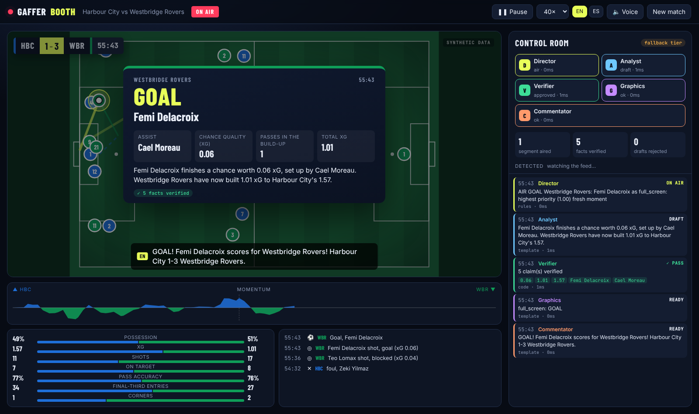
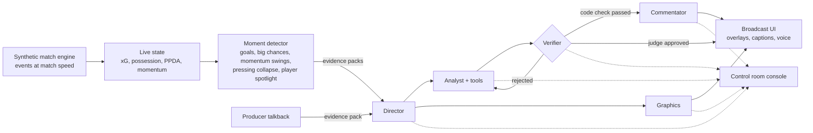

# Gaffer Booth

**An AI broadcast crew for football.** Five agents watch a live match feed, decide what matters, explain why, prove every number, and put it on air as graphics and multilingual commentary.

Built for the Microsoft × Premier League **Inside the Game: Developer Hackathon**. All clubs, players and match data are synthetic.



## What it does

A TV production team turns raw match data into story: someone spots the moment, an analyst explains it, a graphics operator builds the overlay, and a commentator says it out loud. Gaffer Booth does that in real time with an agent crew:

| Agent | Job |
|---|---|
| **Director** | Watches the queue of detected moments and decides what goes on air, in which graphic slot, and what is now too stale to show. |
| **Analyst** | Explains *why* the moment matters in one or two sentences, calling tools for team stats, recent trends, or a player's numbers. |
| **Verifier** | Checks every number, scoreline, clock and player name against the evidence. Rejects hallucinations and sends the Analyst back for a rewrite. |
| **Graphics** | Picks which facts belong on the overlay. It returns fact *keys* only, and code fills in the values, so a graphic can never show a wrong number. |
| **Commentator** | Voices the moment in up to three languages at once, and each line is verified as well. |

During the broadcast the producer can use **talkback**: type a question in the control room ("why are Harbour City losing midfield?", "give me a stat on Wes Varga") and the crew answers it on air next. Code builds an evidence pack for the player or team named, the Analyst answers with its tools, and the answer goes through the same verifier loop before it airs as a graphic plus commentary. With no model, the template tier answers from the same stats.

After the final whistle, `GET /api/recap` produces a verified match report, player ratings (computed in code) and ready-to-post social copy for studio and club media teams.

Every segment on air carries a **"✓ N facts verified"** badge, and the control room shows each claim mapped to the evidence it came from.

## How it works



Key design choices:

- **Code computes, models explain.** All statistics come from the live state engine. Agents receive evidence packs and may only cite numbers in them or in tool results.
- **Explainable by construction.** The verifier maps every number in every sentence back to a named fact. You can see the mapping in the control room.
- **Always on time.** Live TV does not wait. Each agent has a deterministic fallback tier: if a model is slow, unavailable, or fails verification twice, the template tier airs a correct segment instead. The Director drops moments the match has moved past.
- **Real-time multi-agent orchestration.** Moments queue up while the crew is busy, and the Director prioritizes, so a goal pre-empts a substitution. Within a segment the agents overlap: Graphics works alongside the Analyst, and the Commentator starts once the code verifier passes, while the LLM judge is still checking (its line is thrown away if the judge rejects). Goals skip the Director model, and a goal that would wait too long behind another segment airs at once from the verified template tier as a breaking segment, so it is never dropped.

## Synthetic data

`booth/sim` is a seeded, deterministic match engine with four fictional clubs. It models possession chains, passes, carries, dribbles, crosses, shots (with a distance and angle xG model), saves, corners, fouls, cards, offsides, substitutions and fatigue-driven pressing decline. Over many matches it averages about 3 goals, 30 shots and 78% pass completion.

Each scenario has a storyline (a comeback, a red card, a pressing collapse). The engine searches seeds deterministically for a match that fits, so demos are reproducible.

## Microsoft technologies

- **Microsoft Agent Framework**: every crew member is an `agent_framework.Agent` with structured outputs, and the Analyst uses function tools.
- **Microsoft Foundry**: the model behind the crew, called through `FoundryChatClient` with keyless Entra ID auth.
- **Azure Container Apps**: hosts the FastAPI and WebSocket app, provisioned with Bicep through `azd`.
- **Azure Container Registry, Managed Identity, Log Analytics**.
- **GitHub Copilot** was used while building.

## Run locally

```bash
# backend
python -m venv .venv && . .venv/bin/activate
pip install -e ".[dev]"
uvicorn booth.server:app --reload

# frontend (separate terminal)
cd web && npm install && npm run dev   # http://localhost:5173
```

With no model configured the crew runs on its fallback tier. To use a model, copy `.env.example` to `.env` and fill in one block. Any OpenAI-compatible endpoint works, including free ones:

```bash
# OpenRouter free models (OPENROUTER_API_KEY=<your key> alone also works)
OPENAI_BASE_URL=https://openrouter.ai/api/v1
OPENAI_API_KEY=<your key>
OPENAI_MODEL=nvidia/nemotron-3.5-super-vl:free   # the default on OpenRouter
BOOTH_LLM_TIMEOUT=15                              # free models answer in ~5-12 s

# or GitHub Models (free, rate-limited)
OPENAI_BASE_URL=https://models.github.ai/inference
OPENAI_API_KEY=<GitHub token with Models access>
OPENAI_MODEL=openai/gpt-4.1-mini

# or a Microsoft Foundry project
FOUNDRY_PROJECT_ENDPOINT=https://<account>.services.ai.azure.com/api/projects/<project>
FOUNDRY_MODEL=gpt-4.1-mini
```

We ran a short match on every free OpenRouter model in October 2026. `nvidia/nemotron-3.5-super-vl:free` kept all five agents on the model, with every line verified in English, Spanish and French, at about 18 seconds per segment. `liquid/lfm-2.5-2.6b:free` is faster (about 12 seconds) but its copy is looser. Several others timed out, were rate-limited upstream, or are blocked for apps.

Models that don't support structured output are detected on the first call; the crew then asks for JSON in the prompt instead. Free tiers cap daily requests, and a full match makes many calls, so join a match late (the start minute on the setup screen) for short demos. When a call fails or hits a cap, that segment airs from the template tier.

## Deploy to Azure

```bash
azd up
```

This provisions a Foundry account and project with a `gpt-4.1-mini` deployment, Container Apps, ACR and a managed identity with the `Azure AI User` role, then builds and deploys the container.

## Tests

```bash
pytest            # simulator realism, verifier, crew retry path, WebSocket stream
ruff check booth tests
cd web && npm run typecheck && npm run lint
```

## Layout

```
booth/sim      synthetic match engine and scenarios
booth/intel    live state, metrics and moment detection
booth/crew     agents, verifier, graphics builder, fallback tier
booth/server   FastAPI app and WebSocket broadcast
web/           React broadcast UI and control room
infra/         Bicep for Foundry and Container Apps
```
